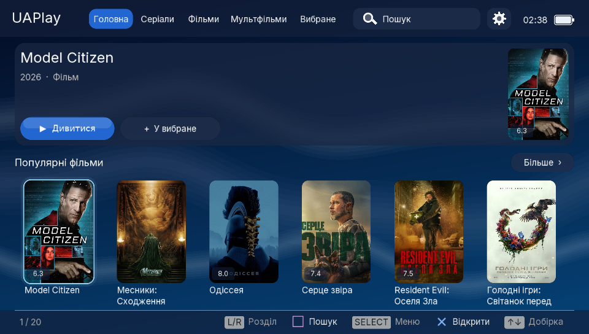
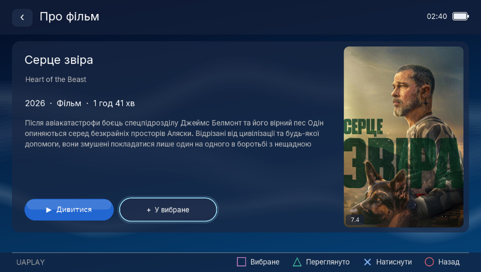
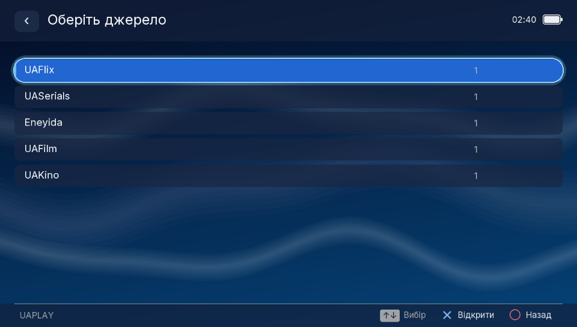
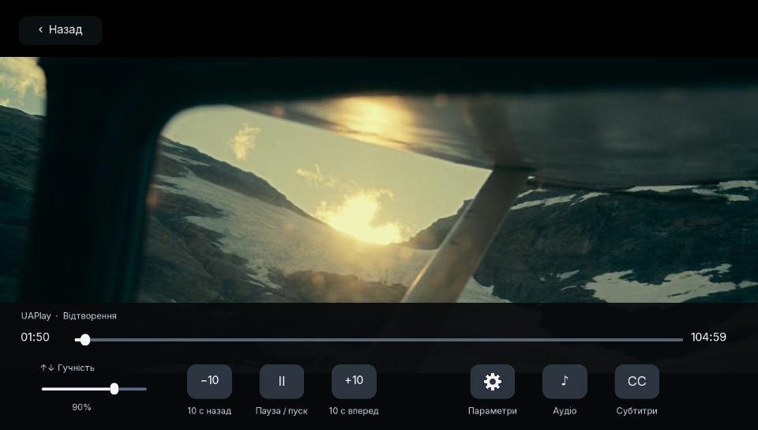
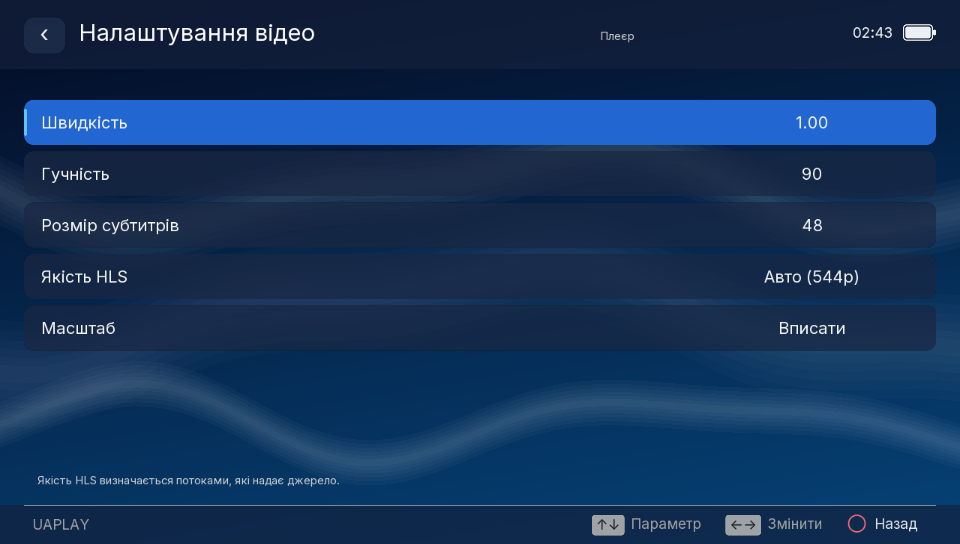
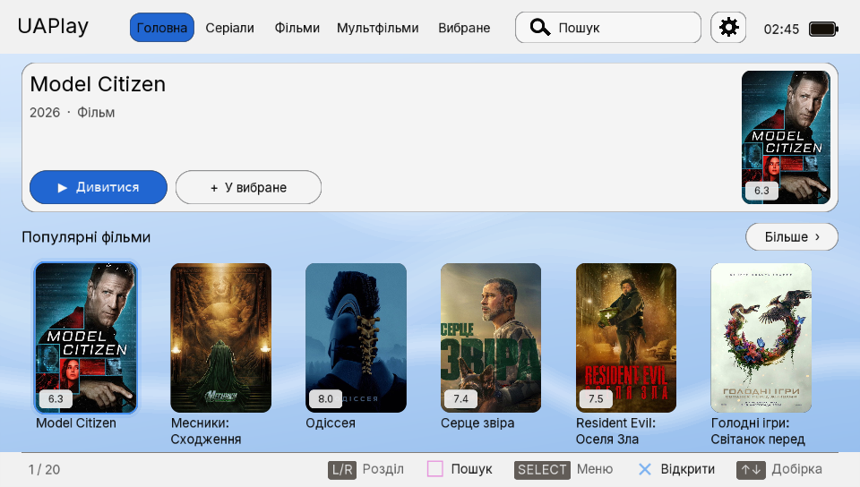

<p align="center">
  
</p>

<h1 align="center">UAPlay</h1>

<p align="center">
  A native, controller-first movie and series app for <b>Nintendo Switch</b> and <b>PS Vita</b>.<br>
  TMDB catalogue · Ukrainian streaming sources · built-in HLS player. No browser engine.
</p>

<p align="center">
  
  
  
  
</p>

---

## Screenshots

Captured from the PS Vita build running in Vita3K (960 × 544).

| Home | Title details |
|:---:|:---:|
|  |  |
| **Sources found in the background** | **Player** |
|  |  |
| **Video settings** | **Light theme** |
|  |  |

## Highlights

- **Catalogue from TMDB in Ukrainian.** Home picks, series, films by genre, animation and anime, search, live posters with a disk cache.
- **Seven sources:** UAFlix, UASerials, Eneyida, UAFilm, UAKino, Mikai and AnimeON (the last two for anime series). Opening a title searches all of them in the background; only providers that returned results are listed, with their counts.
- **Seasons and episodes** browser, autoplay of the next episode, and resume from the last position.
- **Player:** pause, ±10 s seek (hold R for ±60 s), timeline and volume by touch, audio-track and subtitle pickers (including external WebVTT), speed, subtitle size, HLS quality, and fit/fill scaling.
- **Library:** favourites (“На майбутнє”), watch history (“Історія”) and playback positions, stored locally only. No accounts and no sync.
- **Country filter:** productions whose TMDB origin or production countries include RU are hidden. Titles whose countries can't be verified are hidden too.
- **Touch everywhere:** cards, tabs, lists and the player overlay respond to touch.
- **Dark and light themes**, with a PS Vita system-style look on Vita: lit wallpaper with drifting light ribbons, glass panels, blue selection and coloured ✕○□△ button hints.

## Platforms

| | Nintendo Switch | PS Vita |
|---|---|---|
| Package | `UAPlay.nro` | `UAPlay.vpk` (title ID `UAPL00001`) |
| Graphics | SDL2 + OpenGL ES | vitaGL (UI laid out at 1280 × 720 and scaled to 960 × 544) |
| Player | libmpv | `vita/mpv_vita.c`: an mpv-compatible player on FFmpeg, the hardware H.264 decoder and SceAudioOut |
| Default HLS quality | Highest offered | Sharpest variant no taller than 544 lines |
| Search keyboard | System software keyboard | System IME (English and Russian layouts) |
| Data folder | `sdmc:/switch/uaplay/` | `ux0:data/uaplay/` |

## Install

### Nintendo Switch

1. Copy `UAPlay.nro` to `sdmc:/switch/UAPlay.nro`.
2. Open the Homebrew Menu in **full application mode** (hold R while launching a game) and start UAPlay.

### PS Vita

1. Install `UAPlay.vpk` with VitaShell.
2. Make sure `ur0:data/external/libshacccg.suprx` exists. Every vitaGL app needs it; it can be extracted with the ShaRKBR33D plugin.

### TMDB key

Release builds embed the TMDB key from the `TMDB_API_KEY` GitHub Actions secret, so nothing else is needed. The key is not in the source tree. To override it, or for local builds without it, put the 32-character key in `tmdb.key` inside the data folder. On Switch the older `sdmc:/switch/lampa-nx/tmdb.key` is also read. Without network access a small built-in offline catalogue is shown.

## Controls

| Action | Switch | PS Vita |
|---|---|---|
| Confirm / open | A | ✕ (○ on Japanese consoles) |
| Back | B | ○ (✕ on Japanese consoles) |
| Search · favourite | X | □ |
| Mark as watched · audio track | Y | △ |
| Change section | L / R | L / R |
| Menu · video settings | − | SELECT |
| Exit | + | START |

| Screen | Buttons |
|---|---|
| Catalogue | D-pad or either stick to move, L/R section, A details, X search, Minus settings, Plus exit |
| Details | A find sources, X favourite, Y mark watched, B back |
| Sources | Up/down select, A open (series: seasons), B back |
| Seasons / episodes | Up/down select, A open / play, B back |
| Player | A pause, left/right ±10 s, **hold R + left/right ±60 s**, X subtitles, Y audio, Minus video settings, L next episode, B stop and save position |
| Video settings | Up/down choose, left/right change, B back to the video |

The player overlay hides after 3 seconds and comes back on any button or tap. Opening the video settings from the player pauses the video until you go back. On Vita only the front touchscreen is used; the rear touchpad is ignored.

## How sources work

UAPlay is **not** the UAFresh JavaScript plugin running inside Lampa: that plugin needs a browser and the `Lampa.*` runtime. The adapter here reimplements the parts it needs in C.

- Catalogue and episode pages are fetched directly from the console first, with the [UAFresh](https://uakino.ofreshofresh.workers.dev/uakino.js) Worker as a fallback.
- Embedded players (for example Zetvideo) go through the Worker first. A direct request can return an HTTP 200 that actually contains an nginx 404 page.
- Search results are parsed from real result cards, filtered by film/series type, and labelled with their real titles.
- Embedded video resolution covers Zetvideo HLS, PlayerJS playlists (dubs and subtitles) and bounded nested iframes.
- AnimeON and Mikai return native episode lists. Their video hosts go through the same resolver, so a listed episode is not a guarantee that it plays. MoonAnime, for example, may answer HTTP 500. No AnimeON or Mikai credentials are embedded.

## Building

### Nintendo Switch

The [GitHub Actions workflow](.github/workflows/build.yml) builds the NRO in the `devkitpro/devkita64` container. It uses `switch-sdl2`, `switch-sdl2_ttf`, `switch-sdl2_image` and `switch-curl`, plus network-enabled FFmpeg and libmpv packages, and writes `source/tmdb_build_key.h` from the secret. The same steps work locally with devkitPro:

```sh
export DEVKITPRO=/opt/devkitpro PATH=$DEVKITPRO/devkitA64/bin:$DEVKITPRO/tools/bin:$PATH
make
```

### PS Vita

Use Linux or WSL with VitaSDK. Install these vdpm packages, plus vitaGL:

`sdl2 sdl2_ttf sdl2_image openssl-1.1.1 zstd freetype harfbuzz libpng libjpeg-turbo libwebp`

curl and FFmpeg have to be built from source: the vdpm curl targets OpenSSL 1.0.2, which fails modern TLS handshakes, and the vdpm FFmpeg has no network input. The two scripts install them into `~/uaplay-vita-deps`:

```sh
export VITASDK=/usr/local/vitasdk PATH=$VITASDK/bin:$PATH
sh vita/build-curl.sh && sh vita/build-ffmpeg.sh
make -f Makefile.vita          # -> UAPlay.vpk
```

To embed a TMDB key locally, create `source/tmdb_build_key.h` as the workflow does. The file is git-ignored.

### Host-side tests

The source adapters also compile on a desktop for quick checks:

```sh
cc -O2 -Isource source/catalog.c tests/uafresh_smoke.c \
  $(pkg-config --cflags --libs libcurl) -o /tmp/uafresh-smoke && /tmp/uafresh-smoke
cc -O2 -Isource source/catalog.c tests/episodes_smoke.c \
  $(pkg-config --cflags --libs libcurl) -o /tmp/uaflix-episodes-smoke && /tmp/uaflix-episodes-smoke
```

## Project layout

```
source/          shared app: UI, catalogue + source adapters, posters, library, mpv glue
source/platform.h  storage paths per console
vita/            PS Vita platform layer, mpv-compatible player, curl/FFmpeg build scripts
vita/include/    mpv and GLES2 headers for the Vita build
romfs/           fonts and the offline catalogue snapshot
tests/           host-side smoke tests
```

## Limitations

- This is an **experimental native app**, not a feature-for-feature reimplementation of Lampa.
- Availability depends on the providers. Some pages are trailers only, region-locked or removed, and not every video host resolves to a direct stream. The provider's page for *Avatar: The Last Airbender (2024)* S1E1, for example, contains only a YouTube trailer without an account.
- HLS quality presets only matter when the source offers several variants.
- The audio and subtitle pickers list only tracks actually present in the stream.
- **PS Vita:**
  - Not yet tested on real hardware; development used Vita3K.
  - Vita3K can't output the hardware decoder's pictures, so there the player falls back to software decoding. On a real console the hardware decoder should be used.
  - The system IME has no Ukrainian layout.
  - Japanese titles need `NotoSansCJKjp-Regular.otf` in `romfs/`. The Switch CI downloads it; for the Vita, add it before building.
- Successful compilation is not a runtime guarantee. Test on real hardware.

## Credits and legal

This product uses the TMDB API but is not endorsed or certified by TMDB. No copyrighted video is bundled: UAPlay only resolves links returned by third-party services. Use content you have the right to access.

Fonts:
- [Inter](https://rsms.me/inter/) (SIL OFL 1.1, see `romfs/Inter-OFL.txt`)
- [DejaVu Sans](https://dejavu-fonts.github.io/) (Bitstream Vera–derived licence)
- Google Noto Sans Tamil, Telugu, Devanagari, Malayalam, Bengali, Arabic, Thai and CJK JP (SIL OFL 1.1)
